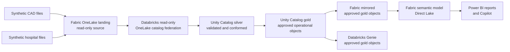

# Ambulance Victoria Databricks–Fabric AI Demo

## Purpose

This demonstration shows a deliberately small, reliable analytics path for operational ambulance data. It uses synthetic computer-aided dispatch (CAD) and hospital data only.

**Fixed demonstration date:** 15 September 2026  
**Snapshot as at:** `2026-09-15T12:00:00Z`

## Architecture

## Data boundaries

| Boundary | Responsibility | Access |
|---|---|---|
| OneLake landing | Retain the synthetic CAD and hospital source data for the fixed snapshot | Databricks federation is read-only |
| Unity Catalog silver | Validate identifiers, timestamps, durations and reference mappings | Engineering-managed |
| Unity Catalog gold | Publish approved, business-ready objects | Read by mirroring and Genie |
| Fabric mirror | Make only approved gold objects available in Fabric | Fabric-managed replica |
| Semantic model | Apply relationships, measures, descriptions and AI guidance | Direct Lake over mirrored objects |
| Consumption | Power BI Copilot and Databricks Genie answer operational questions | Approved users only |

Databricks does not write back to OneLake landing. All transformed data is written to Unity Catalog silver and gold. Fabric receives only the approved gold objects through mirroring.

## Approved gold contract

The demonstration exposes exactly these analytical objects:

- `fact_case`
- `dim_region`
- `dim_hospital`
- `operational_metrics`

`patient_id_hash` and `crew_id_hash` are excluded from the approved gold contract and must be physically absent from mirrored objects and the semantic model. Hiding these columns is not sufficient.

## Reliability choices

- The source dataset and displayed clock are fixed, avoiding changes during presentation.
- The OneLake federation connection is read-only.
- Silver and gold are precomputed before the presentation.
- Only a small approved gold contract is mirrored.
- The semantic model uses Direct Lake; no presentation-time refresh is required.
- Copilot and Genie use curated names, descriptions and verified example questions.
- The demonstration includes a prepared report page and prepared query results as recovery paths.

## Guardrails

1. Use synthetic data only.
2. Treat the snapshot time as `2026-09-15T12:00:00Z`; do not imply live operations.
3. Report operational trends, not clinical advice, patient outcomes or staff performance.
4. Keep region and hospital filters visible when interpreting results.
5. Do not expose row-level person or crew identifiers.
6. Restrict Fabric workspace, semantic model, Power BI report, Unity Catalog and Genie access to the approved demonstration group.
7. Label AI responses as generated and verify totals against the six certified measures.

## Ownership

| Area | Owner |
|---|---|
| Synthetic source and Unity Catalog silver/gold | Databricks engineering |
| OneLake landing, mirroring and semantic model | Fabric team |
| Report, Copilot instructions and presentation | Power BI team |
| Access approval and demonstration sign-off | Ambulance Victoria demonstration owner |
